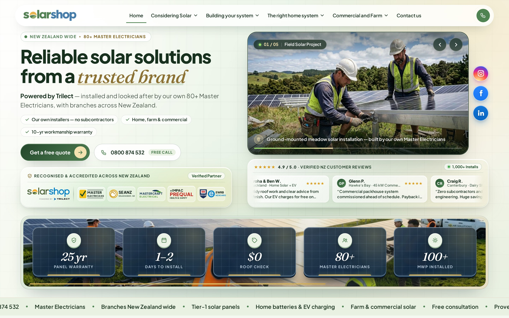

# Solar Shop — Home page with the redesigned Split Editorial & Framed Showcase hero

A faithful, self-contained build of the **Solar Shop** (`solarshop.co.nz`) home page.
Every block — navigation, ticker, cards, products, brand wall, FAQ and footer — is the
live site's own design; **the hero section is newly engineered in a premium Split Editorial & Framed Showcase layout**.

> **Message:** *Reliable solar solutions from a trusted brand.*
> **Tagline:** *Powered by Trilect*

---

## The Hero Section Highlights

| Feature | Details |
|---|---|
| **Layout** | **Split Editorial & Framed Showcase** — editorial typography, trust micro-pills, and CTAs on the left; an unobstructed, framed full-colour 5-photo showcase slider on the right. |
| **Background** | Soft light brand-colour gradient (`#FCFCF7` → `#F1F7EC` → `#E9F3E8` → `#F7F4E9`) with a subtle architectural grid texture. |
| **5-Photo Showcase Slider** | Auto-advancing 5.2 s crossfade slider (`assets/photos/hero-01…05.webp`) featuring Field Solar Project, Home Rooftop, Commercial Solar, Farm & Dairy, and Utility-Scale Solar Farms & BESS, complete with live slide counter (`01 / 05`), category tag, location caption, progress bar, arrows, keyboard (`←` / `→`), and touch swipe. |
| **Social Media Rail** | Circular brand-coloured badges on the right side of the hero stage for **Instagram** (official multi-stop gradient), **Facebook** (`#1877F2`), and **LinkedIn** (`#0A66C2`) with crisp white glyphs. |
| **Frosted-Glass Partner Strip** | Transparent blur (`backdrop-filter: blur(22px)`) card housing the supplied *Solar Shop — Powered by Trilect* lockup alongside high-clarity vector badges for **Master Electricians**, **SEANZ**, **Mastercraft Electrical**, **+IMPAC Prequal**, and **Site Safe & EWRB**. |
| **Continuous Review Slider** | Matching transparent-blur glass card on the right featuring a randomized, non-stop scrolling marquee of verified New Zealand customer reviews (`4.9 / 5.0 ★`). |
| **3D Solar-Panel Stats Bar** | 5 individual 3D monocrystalline solar-panel cards (`25 yr Panel Warranty`, `1–2 Days to Install`, `$0 Roof Check`, `80+ Master Electricians`, `100+ MWp Installed`) with wafer cell grids and golden busbars set over a panoramic New Zealand field solar installation background (`assets/photos/sbar-field-crew.webp`). |

---

## Preview



Desktop hero (1440 px) · [full page](screenshots/home-full-page.jpg) ·
[mobile hero](screenshots/hero-mobile.jpg)

---

## Run it locally

Any static server works — there is no build step:

```bash
# option 1 — Python
python3 -m http.server 8000

# option 2 — Node
npx serve .
```

Then open <http://localhost:8000>.

---

## Deploy to `https://github.com/tezofy/solarshophome/`

**Option A — GitHub Web Upload (Drag & Drop)**
1. Extract `solarshophome-github-push.zip` on your computer.
2. Open <https://github.com/tezofy/solarshophome/> and click **Add file ▸ Upload files**.
3. Drag and drop **all files and folders** from inside the extracted folder (`index.html`, `README.md`, `assets/`, `screenshots/`, `.nojekyll`, `robots.txt`, `sitemap.xml`, `CNAME.sample`).
4. Click **Commit changes** on the `main` branch.

**Option B — Git CLI Push**
```bash
git add -A
git commit -m "Update Solar Shop home hero — Split Editorial & Framed Showcase"
git push origin main
```

---

## Project structure

```
index.html                     the home page (redesigned hero + full live site sections)
assets/
  tokens.css                   design tokens (--hv2-*) for typography, colours, spacing
  hero.css                     Split Editorial hero, frosted glass cards, review marquee & 3D solar stat cards
  hero.js                      5-photo showcase slider controller + randomized continuous review marquee
  site.css, site.js            the live site's own styles/scripts
  fonts.css, fonts/            self-hosted Plus Jakarta Sans + Fraunces Italic
  photos/hero-01…05.webp       the five hero showcase photographs
  photos/sbar-field-crew.webp  panoramic field solar crew background for the bottom stats bar
  supplied/                    client-supplied lockup + accreditation assets
  *.webp, *.png                the rest of the site's images
screenshots/                   desktop, mobile, and full-page preview screenshots
```
